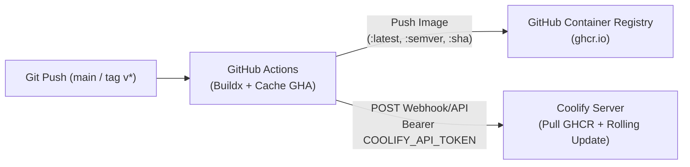

# Skill: CI/CD (GitHub Actions -> GHCR) & Deploy Coolify + PostgreSQL 18

Use este playbook sempre que criar ou alterar Dockerfiles, `docker-compose`, workflows do GitHub Actions (`.github/workflows/*`), migrações Prisma ou configurações de deploy para o **Coolify**.

---

## 1. Arquitetura de CI/CD (Zero Build CPU na VPS)

Para evitar consumo de CPU/RAM na VPS do Coolify durante compilações TypeScript/Vite:



### 1.1 Estrutura do Passo de Disparo via API do Coolify no GitHub Actions
```yaml
      - name: Notificar Coolify via Webhook ou API
        if: ${{ env.COOLIFY_WEBHOOK_URL != '' }}
        env:
          COOLIFY_WEBHOOK_URL: ${{ secrets.COOLIFY_WEBHOOK_URL }}
          COOLIFY_API_TOKEN: ${{ secrets.COOLIFY_API_TOKEN }}
        run: |
          echo "🚀 Disparando solicitação de deploy no Coolify..."
          if [ -n "$COOLIFY_API_TOKEN" ]; then
            RESPONSE=$(curl -s -w "\nHTTP_STATUS:%{http_code}" -X POST "$COOLIFY_WEBHOOK_URL" -H "Authorization: Bearer $COOLIFY_API_TOKEN")
            BODY=$(echo "$RESPONSE" | sed -e '$d')
            STATUS=$(echo "$RESPONSE" | tail -n1 | sed -e 's/HTTP_STATUS://')
            echo "Resposta Coolify (HTTP $STATUS): $BODY"
            if [ "$STATUS" -ge 200 ] && [ "$STATUS" -lt 300 ]; then
              echo "✅ Deploy automático no Coolify enfileirado com sucesso!"
            else
              echo "❌ Falha ao acionar deploy no Coolify (HTTP $STATUS)"
              exit 1
            fi
          else
            curl -f -X POST "$COOLIFY_WEBHOOK_URL" || curl -f -X GET "$COOLIFY_WEBHOOK_URL"
          fi
```

---

## 2. Regras Obrigatórias para Containers no Coolify + Traefik

1. **Rede Externa `coolify`:**
   Em manifests de produção (`apps/docker-compose.prod.yml`), os serviços expostos devem se conectar à rede externa `coolify`:
   ```yaml
   networks:
     silentprint-net:
       driver: bridge
     coolify:
       name: coolify
       external: true
   ```
2. **Labels Explícitas do Traefik (Prevenção de `503 Service Unavailable`):**
   ```yaml
   labels:
     - "traefik.enable=true"
     - "traefik.docker.network=coolify"
     - "traefik.http.services.api.loadbalancer.server.port=3333"
   ```
3. **Proibição de `container_name` Fixo em Produção:**
   Nunca declare `container_name` em `docker-compose.prod.yml`, permitindo que o Coolify realize *rolling updates* criando novos containers antes de encerrar os antigos sem conflito de nomes.
4. **Healthcheck com `start_period: 30s` e SemVer:**
   * A rota `GET /health` da API deve retornar HTTP `200`, o status da conexão com o PostgreSQL 18 e a propriedade `"version"` lida diretamente do `package.json`.
   * O `healthcheck` do container deve ter `start_period: 30s` para dar tempo ao `npx prisma migrate deploy` executar antes da primeira checagem de saúde.
5. **Variável `DATABASE_URL` no Coolify:**
   * No Coolify, utilize a **Internal Database URL** do recurso PostgreSQL 18 diretamente (sem interpolação complexa de variáveis não declaradas), acrescentando `?schema=public`.

---

## 3. Padrão de Dockerfiles Multi-Stage

### 3.1 `apps/api/Dockerfile`
* **Stage 1 (`builder` - `node:22-alpine`):** Instala dependências, gera o Prisma Client (`npx prisma generate`) e compila o TypeScript (`npm run build`).
* **Stage 2 (`runner` - `node:22-alpine`):** Instala `curl` (para healthcheck), copia `dist/`, `node_modules/`, `package.json` e `prisma/`, expõe a porta `3333` e inicia com:
  ```sh
  sh -c "npx prisma migrate deploy && node dist/server.js"
  ```

### 3.2 `apps/web/Dockerfile`
* **Stage 1 (`builder` - `node:22-alpine`):** Recebe `ARG VITE_API_URL` e compila o bundle estático (`npm run build`).
* **Stage 2 (`runner` - `nginx:alpine`):** Copia `dist/` para `/usr/share/nginx/html` e `nginx.conf` configurado para SPA (`try_files $uri $uri/ /index.html;`) na porta `80`.
