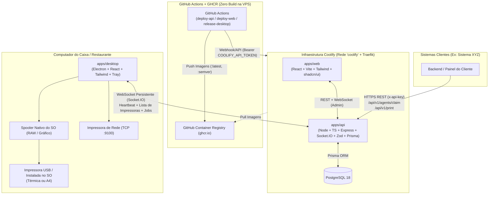
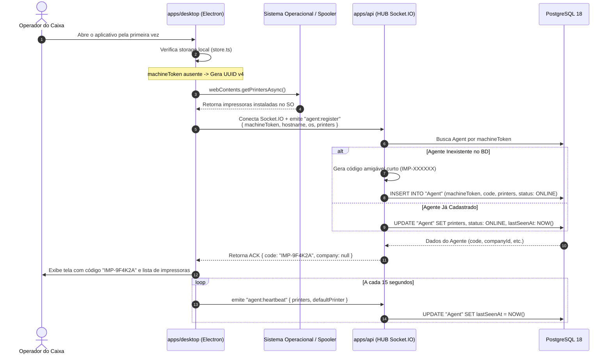
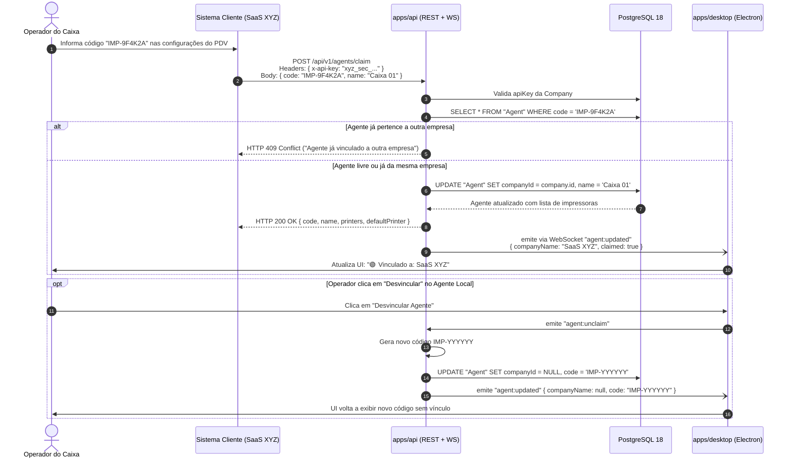
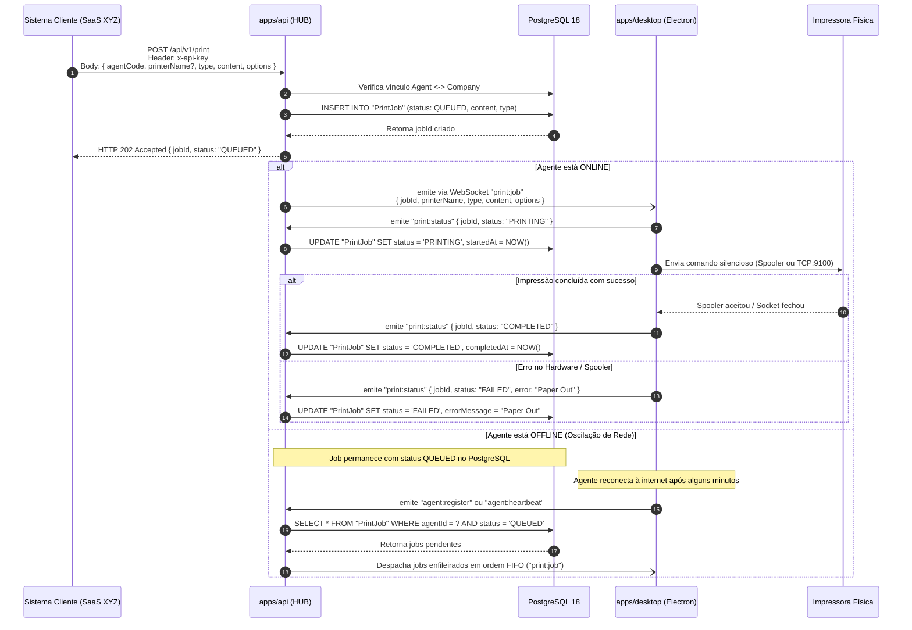
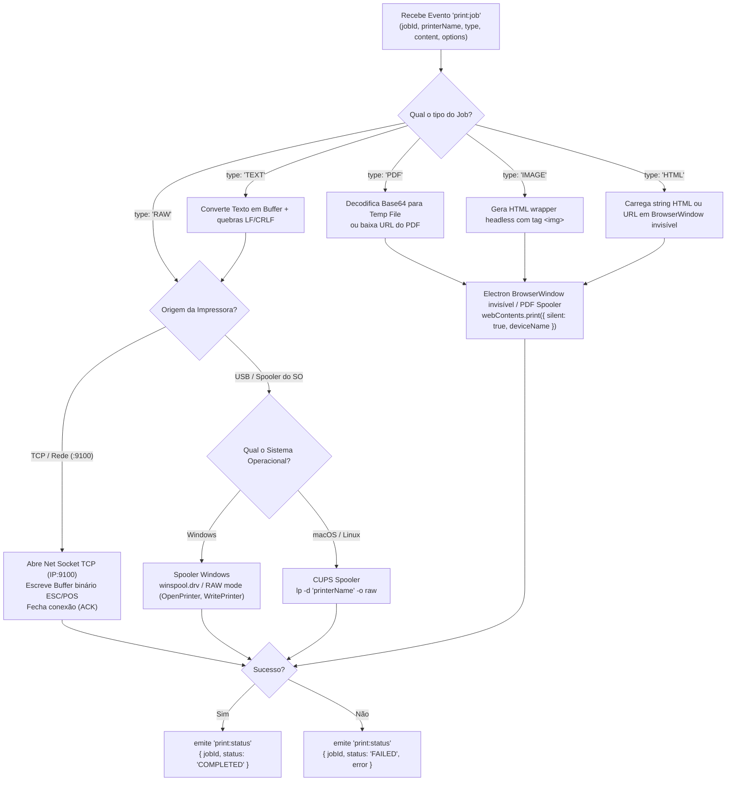
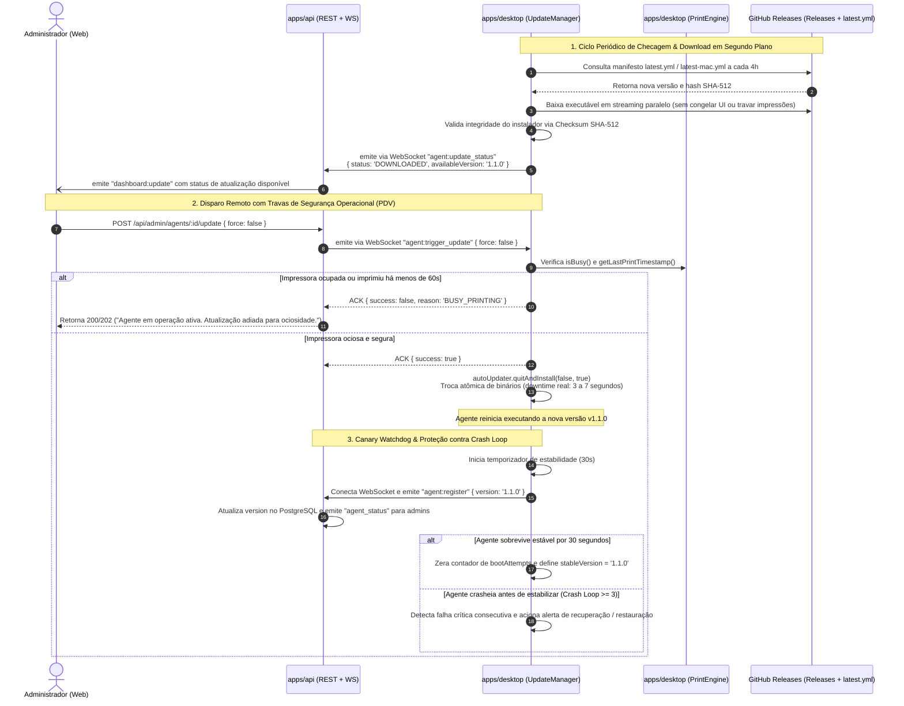

# Plano de Arquitetura e Implementação — Ecossistema de Impressão Silenciosa

Este documento consolida todas as decisões definidas na entrevista de design e detalha o plano de construção dos 3 projetos independentes dentro de `/apps` (`api`, `web`, `desktop`), com esteira completa de CI/CD via **GitHub Actions $\rightarrow$ GHCR $\rightarrow$ API do Coolify**.

---

## 1. Visão Geral da Arquitetura & CI/CD



---

## 1.1 Diagramas de Sequência e Fluxos do Sistema

### Fluxo 1: Onboarding e Descoberta do Agente Local


### Fluxo 2: Vínculo (Claim) e Desvínculo (Unclaim) Multi-Tenant


### Fluxo 3: Ciclo de Vida da Impressão & Fila Offline (Resiliência)


### Fluxo 4: Pipeline Interno do Motor de Impressão Silenciosa (Desktop Print Engine)


### Fluxo 5: Atualização Silenciosa do Desktop Agent, Travas de PDV e Watchdog Rollback


---

## 2. Estrutura de Diretórios do Repositório

```text
AgenteDeImpressao/
├── AGENTS.md                         # Guia central do projeto, regras, arquitetura e índice de .ai/ e docs/
├── .github/
│   └── workflows/
│       ├── deploy-api.yml            # Build/Push apps/api no GHCR + Trigger API Coolify
│       ├── deploy-web.yml            # Build/Push apps/web no GHCR + Trigger API Coolify
│       └── release-desktop.yml       # Build instaladores .exe (Windows) e .dmg (macOS)
├── .ai/                              # Customizações de IA (Agentes especialistas e Skills técnicas)
│   ├── agents/
│   │   ├── api.md                    # Especialista em apps/api
│   │   ├── web.md                    # Especialista em apps/web
│   │   ├── desktop.md                # Especialista em apps/desktop
│   │   └── devops.md                 # Especialista em CI/CD (GHCR), Docker, Traefik e Coolify
│   └── skills/
│       ├── silent-print-engine/
│       │   └── SKILL.md
│       ├── socket-contract-sync/
│       │   └── SKILL.md
│       └── coolify-docker-prisma/
│           └── SKILL.md
├── docs/                             # Artefatos de produto, arquitetura, especificações e deploy
│   ├── PRD.md                        # Product Requirement Document (v2.0) completo
│   ├── ARCHITECTURE_AND_PLAN.md      # Arquitetura detalhada, modelagem, contratos e plano de execução
│   └── deploy/
│       └── coolify.md                # Guia completo de CI/CD (GHCR) e deploy no Coolify
└── apps/                             # Diretório de aplicações independentes
    ├── docker-compose.yml            # Orquestração local (Postgres 18 + api + web)
    ├── docker-compose.prod.yml       # Orquestração de produção Coolify (imagens GHCR + Traefik + rede coolify)
    ├── api/                          # Servidor Backend + WebSocket Hub
    │   ├── Dockerfile
    │   ├── package.json
    │   ├── prisma/
    │   │   ├── schema.prisma         # Schema Postgres 18 (AdminUser, Company, Agent, PrintJob)
    │   │   └── seed.ts               # Seed inicial (Admin + Empresa Demo)
    │   └── src/
    │       ├── config/               # Env (Zod), Prisma Client
    │       ├── middlewares/          # Auth JWT (Admin) e Auth API_KEY (Empresas)
    │       ├── routes/               # Rotas Admin (/api/admin/*) e Clientes (/api/v1/*)
    │       ├── services/             # Geração de código IMP-XXXXXX, Fila de Impressão, Dispatch
    │       ├── websocket/            # Handlers Socket.IO (Agentes e Dashboard Live)
    │       └── server.ts
    ├── web/                          # Painel Web Administrativo
    │   ├── Dockerfile
    │   ├── nginx.conf
    │   ├── package.json
    │   └── src/
    │       ├── components/           # Componentes UI (shadcn/ui) + Layout
    │       ├── pages/
    │       │   ├── Login.tsx
    │       │   ├── Dashboard.tsx     # Visão Geral + Métricas em tempo real
    │       │   ├── Companies.tsx     # Cadastro de Empresas + Gestão de API Keys
    │       │   ├── Agents.tsx        # Agentes por Empresa e Sem Vínculo + Controle Remoto
    │       │   ├── Playground.tsx    # Disparador de Testes (Texto, ESC/POS, PDF, Imagem, HTML)
    │       │   └── Jobs.tsx          # Histórico e Fila de Impressões
    │       └── lib/                  # API Client + Socket.IO Client
    └── desktop/                      # Aplicativo Desktop Local (Electron)
        ├── package.json
        ├── electron-builder.yml      # Configuração de build .exe (Windows) e .dmg (macOS)
        └── src/
            ├── main/                 # Processo Principal Electron
            │   ├── index.ts          # Janela, System Tray, Autostart, IPC
            │   ├── socket-client.ts  # Conexão Socket.IO com o HUB + Heartbeat
            │   ├── printer-discovery.ts # Listagem via getPrintersAsync() + Impressoras TCP/9100
            │   ├── print-engine.ts   # Motor Agnóstico (TEXT, RAW/ESC-POS, PDF, IMAGE, HTML)
            │   └── store.ts          # Persistência local (machineToken, defaultPrinter, hubUrl)
            ├── preload/              # Ponte segura ContextBridge (IPC)
            └── renderer/             # Interface Visual (React + Tailwind)
```

---

## 3. Modelagem de Dados (`apps/api/prisma/schema.prisma`)

* **`AdminUser`**: Administradores do Painel Web do HUB (`id`, `email`, `passwordHash`, `name`, `createdAt`, `updatedAt`).
* **`Company`**: Clientes/Empresas cadastradas no HUB (`id`, `name`, `slug`, `apiKey`, `active`, `createdAt`, `updatedAt`).
* **`Agent`**: Cada instalação do Agente Desktop (`id`, `machineToken` único secreto do agente, `code` único público no formato `IMP-XXXXXX`, `name` ex: "Caixa 01", `companyId` opcional/`null` quando sem vínculo, `status` `ONLINE`/`OFFLINE`, `lastSeenAt`, `hostname`, `os`, `version`, `ipAddress`, `defaultPrinter`, `printers` em JSONB, `createdAt`, `updatedAt`).
* **`PrintJob`**: Histórico e fila de trabalhos de impressão (`id`, `companyId`, `agentId`, `printerName`, `title`, `type` enum `TEXT | RAW | PDF | IMAGE | HTML`, `content`, `options` JSONB, `status` enum `QUEUED | PRINTING | COMPLETED | FAILED`, `errorMessage`, `createdAt`, `startedAt`, `completedAt`).

---

## 4. Contrato de Comunicação (WebSocket & REST)

### 4.1 Eventos Socket.IO (`apps/api` $\leftrightarrow$ `apps/desktop`)
| Evento | Direção | Descrição |
| :--- | :--- | :--- |
| `agent:register` | Agente $\rightarrow$ HUB | Envia `machineToken`, `hostname`, `os`, `version`, `defaultPrinter` e array `printers`. O HUB retorna o `code` (`IMP-XXXXXX`) e dados da `company` vinculada (se houver) + despacha jobs pendentes na fila. |
| `agent:heartbeat` | Agente $\rightarrow$ HUB | Enviado a cada 15s com status e lista atualizada de impressoras do SO. |
| `agent:set-default-printer` | Agente $\rightarrow$ HUB | Atualiza a impressora padrão selecionada pelo usuário na interface local do Agente. |
| `agent:unclaim` | Agente $\rightarrow$ HUB | Disparado quando o usuário clica em "Desvincular" no App Local; limpa `companyId` e gera um novo código `IMP-XXXXXX`. |
| `agent:updated` | HUB $\rightarrow$ Agente | Notifica o Agente em tempo real quando ele é vinculado/desvinculado de uma empresa ou quando a impressora padrão é alterada remotamente. |
| `print:job` | HUB $\rightarrow$ Agente | Envia o job (`jobId`, `printerName`, `type`, `content`, `options`). |
| `print:status` | Agente $\rightarrow$ HUB | Reporta mudança de estado do job (`PRINTING`, `COMPLETED` ou `FAILED` com mensagem de erro). |

### 4.2 Endpoints REST para Sistemas Clientes (`/api/v1/*` via header `x-api-key`)
* `POST /api/v1/agents/claim` — Vincula um agente informando `{ code: "IMP-XXXXXX", name?: "Caixa 01" }`. Retorna erro `409` se já pertencer a outra empresa. Retorna os dados do agente e todas as suas impressoras.
* `POST /api/v1/agents/:code/unclaim` — Desvincula o agente da empresa atual e rotaciona seu código.
* `GET /api/v1/agents` — Lista todos os agentes vinculados à empresa da `API_KEY` (com status `ONLINE`/`OFFLINE` e lista de impressoras).
* `PATCH /api/v1/agents/:code` — Altera apelido ou `defaultPrinter` do agente.
* `POST /api/v1/print` — Cria e dispara uma impressão imediata (ou enfileira se o agente estiver reconectando).
* `GET /api/v1/jobs` & `GET /api/v1/jobs/:id` — Consulta status e histórico de impressões da empresa.

### 4.3 Endpoints REST para o Painel Admin (`/api/admin/*` via Bearer JWT)
* `POST /api/admin/auth/login` & `GET /api/admin/auth/me`
* `GET /api/admin/stats` — Estatísticas gerais do dashboard.
* `GET /api/admin/companies`, `POST /api/admin/companies`, `PATCH /api/admin/companies/:id`, `POST /api/admin/companies/:id/regenerate-key`, `DELETE /api/admin/companies/:id`
* `GET /api/admin/agents` (com filtros `companyId`, `unassigned=true`, `status`), `POST /api/admin/agents/:id/assign`, `POST /api/admin/agents/:id/unclaim`, `PATCH /api/admin/agents/:id`
* `POST /api/admin/print-test` — Dispara um trabalho de impressão de teste pelo Playground do Painel Admin para qualquer Agente.
* `GET /api/admin/jobs` — Histórico global e fila de impressões com filtros.
* `POST /api/admin/agents/:id/update` — Dispara comando remoto de atualização (`agent:trigger_update`) para o Desktop Agent via WebSocket.

### 4.4 Endpoints Públicos de Download (`/api/downloads/*`)
* `GET /api/downloads/info` — Retorna metadados da versão do Desktop Agent (`v1.0.0`), tamanhos e disponibilidade dos instaladores.
* `GET /api/downloads/windows` — Download direto do instalador Windows (`.exe` NSIS) servido pelo servidor/volume ou redirecionamento configurado.
* `GET /api/downloads/mac` — Download direto da imagem de disco macOS (`.dmg`).

---

## 5. Etapas de Execução

1. **Etapa 1 — Infraestrutura Docker & `apps/api` (Backend + Prisma + Postgres 18 + Socket.IO)**
   * Configurar `apps/docker-compose.yml` (dev) e `apps/docker-compose.prod.yml` (Coolify/Traefik) com `postgres:18-alpine`, `api` e `web`.
   * Criar schema Prisma, seed do Admin inicial, rotas de Admin, rotas `/api/v1/*` para Empresas, motor Socket.IO, fila de jobs e healthcheck com SemVer.
2. **Etapa 2 — `apps/web` (Painel Web React + Vite + Tailwind + shadcn/ui)**
   * Construir interface completa: Login, Dashboard em tempo real, Gestão de Empresas e `API_KEY`s, Monitoramento de Agentes (por empresa e sem vínculo), Playground de Impressão e Histórico de Jobs.
3. **Etapa 3 — `apps/desktop` (App Electron + Motor de Impressão Agnóstico)**
   * Construir o processo principal Electron (System Tray, Autostart, descoberta de impressoras do SO + TCP/9100, motor de impressão silenciosa para `TEXT`, `RAW/ESC-POS`, `PDF`, `IMAGE`, `HTML` em Windows/macOS/Linux) e a interface visual React do Agente Local.
4. **Etapa 4 — Testes Integrados Ponta a Ponta**
   * Subir o ambiente, validar o registro automático de código `IMP-XXXXXX`, o fluxo de `claim`/`unclaim`, o monitoramento em tempo real e o disparo dos formatos de impressão.
