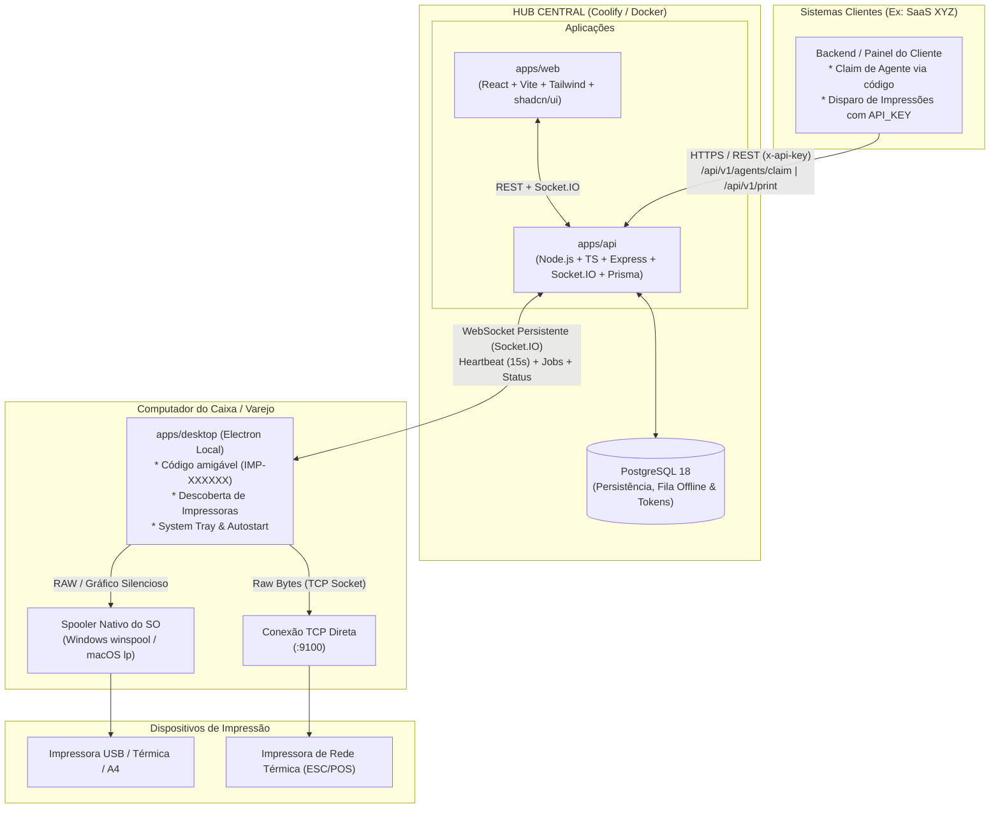

# Product Requirement Document (PRD) v2.0 — Hub & Agente de Impressão Silenciosa

## 1. Visão Geral do Produto
O objetivo deste projeto é desenvolver uma plataforma completa de **Impressão Silenciosa Remota (Cloud-to-Local Print Bridge)** composta por um **Servidor HUB Central (`apps/api`)**, um **Painel Web de Gestão (`apps/web`)** e um **Agente Desktop Local (`apps/desktop`)**.

Diferente de abordagens legadas que dependem de requisições HTTP diretas do navegador para `localhost` (sujeitas a bloqueios de CORS/HTTPS/Private Network Access) ou acopladas a um único layout fixo, o ecossistema opera como uma **ponte agnóstica ao conteúdo** (inspirada em soluções como PrintNode/QZ Tray) com **monitoramento centralizado em tempo real**.

### 1.1 Público-Alvo
* **Operadores de Caixa / Restaurantes / Varejo (Usuários do Agente Desktop):** Usuários leigos em tecnologia. O processo de instalação, configuração de periféricos e operação diária é 100% visual e livre de interações via terminal (CLI).
* **Sistemas SaaS Clientes (Ex: Sistema XYZ):** Sistemas web de gestão/PDV que precisam disparar impressões silenciosas para os computadores de seus clientes através da API do HUB usando sua `API_KEY`.
* **Administradores do HUB:** Equipe responsável por gerenciar as Empresas clientes, suas `API_KEY`s e monitorar todos os Agentes conectados em tempo real.

### 1.2 Principais Diferenciais Arquiteturais
* **Comunicação 100% via HUB (WebSocket/Socket.IO):** O Agente Local mantém conexão persistente com o HUB na nuvem, enviando sinais de vida (*heartbeats*) e a lista atualizada de impressoras instaladas no Sistema Operacional.
* **Isolamento Multi-Empresa (Multi-Tenant):** Sistemas SaaS clientes (ex: *Sistema XYZ*) comunicam-se exclusivamente com a API REST do HUB usando sua `API_KEY`. Apenas o HUB se comunica diretamente com os Agentes Locais.
* **Onboarding Simplificado por Código Único:** Ao ser instalado, o Agente Local recebe do HUB um código único amigável (ex: `IMP-9F4K2A`). O operador cola esse código no sistema da sua empresa, que chama a API do HUB para vincular o Agente e enxergar todas as impressoras daquele computador.
* **Impressão Agnóstica ao Conteúdo:** O Agente imprime silenciosamente (sem abrir janelas ou diálogos) qualquer formato enviado pelo HUB: **Texto Puro**, **RAW / ESC-POS (Base64/Hex)**, **PDF (Base64 ou URL)** e **Imagem / HTML (Base64, URL ou String HTML)**, tanto em impressoras térmicas (bobina) quanto em impressoras comuns (A4/Etiquetas).

---

## 2. Arquitetura do Ecossistema

---

## 3. Fluxos de Experiência e Onboarding

### 3.1 Cadastro da Empresa no HUB (`apps/web`)
1. O Administrador acessa o **Painel Web do HUB** (`apps/web`) e realiza login.
2. Cadastra uma nova **Empresa/Cliente** (ex: *Sistema XYZ* ou *Restaurante Sabor*).
3. O HUB gera uma `API_KEY` exclusiva para aquela empresa (com opção de copiar, regenerar ou revogar).

### 3.2 Onboarding do Agente Desktop (`apps/desktop`)
1. O usuário baixa e executa o instalador do **Agente Desktop** no computador do caixa.
2. Na primeira execução, o Agente gera um `machineToken` persistente local e conecta via WebSocket ao **HUB**.
3. O **HUB** registra o novo Agente no banco de dados (inicialmente no estado **"Sem Empresa Vinculada"**) e gera um **código único curto** garantido pelo Postgres (ex: `IMP-9F4K2A`), devolvendo-o ao Agente.
4. Na janela do **Agente Local**, o usuário visualiza:
   * O código `IMP-9F4K2A` em destaque com botão **"Copiar Código"**.
   * Status da conexão em tempo real (`🟢 Conectado ao Hub`).
   * Lista de todas as impressoras instaladas no Sistema Operacional (+ opção de adicionar impressora de rede IP/9100), podendo escolher a **Impressora Padrão** e clicar em **"Imprimir Teste"**.

### 3.3 Vínculo (Claim) pelo Sistema Cliente ou Painel do HUB
1. O usuário copia o código `IMP-9F4K2A` do Agente Local e o digita na tela de configuração do **Sistema XYZ** (ou o Admin vincula diretamente pelo Painel do HUB).
2. O backend do Sistema XYZ envia `POST /api/v1/agents/claim` para o HUB autenticado com sua `API_KEY`, informando `{ "code": "IMP-9F4K2A", "name": "Caixa 01" }`.
3. O HUB valida que o Agente não pertence a outra empresa, realiza o vínculo, retorna para o Sistema XYZ a lista completa de impressoras daquele PC (e qual é a padrão) e notifica o Agente Local via WebSocket (que passa a exibir `"Vinculado a: Empresa XYZ"`).
4. **Regra de Segurança de Desvínculo:** Um Agente já vinculado não pode ser tomado por outra empresa sem antes ser desvinculado pelo Admin no Painel do HUB, via API pela própria empresa atual (`POST /api/v1/agents/:code/unclaim`), ou pelo botão **"Desvincular"** no Agente Local (que limpa o vínculo e solicita ao HUB um novo código `IMP-XXXXXX`).

### 3.4 Disparo de Impressão e Fila de Resiliência
1. A empresa envia `POST /api/v1/print` para o HUB com sua `API_KEY`, informando:
   * `agentCode` (ex: `IMP-9F4K2A`)
   * `printerName` (opcional — se omitido, usa a `defaultPrinter` configurada no Agente)
   * `type`: `'TEXT' | 'RAW' | 'PDF' | 'IMAGE' | 'HTML'`
   * `content`: conteúdo (texto, Base64, Hex, HTML ou URL)
   * `options`: cópias, corte de papel (`cut`), codificação, etc.
2. O HUB registra o Job no Postgres (`status: QUEUED`):
   * Se o Agente estiver **Online**, emite imediatamente o evento `print:job` via Socket.IO.
   * Se o Agente estiver momentaneamente **Offline** (oscilação de internet), mantém o Job na fila pendente e o entrega automaticamente assim que o Agente reconectar (dentro do TTL configurável).
3. O Agente executa a impressão silenciosa, reporta `PRINTING` e em seguida `COMPLETED` (ou `FAILED` com detalhes técnicos do erro).

---

## 4. Requisitos Funcionais por Módulo

### 4.1 Módulo 1: `apps/api` (Backend & WebSocket Hub)
* **RF-API-01:** Autenticação de Admin (JWT) para o Painel Web e autenticação por `x-api-key` para chamadas de Empresas clientes.
* **RF-API-02:** CRUD de Empresas (`Company`) e gerenciamento de `API_KEY`s por empresa.
* **RF-API-03:** Servidor Socket.IO com eventos dedicados para Agentes Locais (`agent:register`, `agent:heartbeat`, `agent:set-default-printer`, `agent:unclaim`, `print:job`, `print:status`) e para atualização em tempo real do Painel Web (`dashboard:update`).
* **RF-API-04:** Geração atômica de código único (`IMP-XXXXXX`) no PostgreSQL no primeiro registro do Agente e na rotação por desvínculo.
* **RF-API-05:** Endpoints REST para Empresas clientes:
  * `POST /api/v1/agents/claim` — Vincula um Agente pelo código `IMP-XXXXXX`.
  * `POST /api/v1/agents/:code/unclaim` — Desvincula um Agente da empresa.
  * `GET /api/v1/agents` — Lista todos os Agentes da empresa, status online/offline, último sinal de vida, impressora padrão e lista de impressoras.
  * `PATCH /api/v1/agents/:code` — Atualiza apelido do Agente ou sua impressora padrão remotamente.
  * `POST /api/v1/print` — Envia um job de impressão (`TEXT`, `RAW`, `PDF`, `IMAGE`, `HTML`).
  * `GET /api/v1/jobs` e `GET /api/v1/jobs/:id` — Consulta status e histórico de impressões.
* **RF-API-06:** Gestão e Disparo Remoto de Atualizações (`POST /api/admin/agents/:id/update`): Permite que administradores acionem o comando `agent:trigger_update` via WebSocket com confirmação imediata e recepção de telemetria de progresso do update.
* **RF-API-07:** Endpoints Públicos de Download (`GET /api/downloads/*`): Rotas abertas para consultar metadados da versão e baixar instaladores (`.exe` e `.dmg`) servidos diretamente ou via storage externo.

### 4.2 Módulo 2: `apps/web` (Painel Administrativo Web)
* **RF-WEB-01:** Tela de Login Administrativo e Dashboard com métricas em tempo real (Total de Empresas, Agentes Online vs Offline, Agentes Sem Vínculo, Impressões nas últimas 24h).
* **RF-WEB-02:** Gestão de Empresas (criar, editar, ativar/desativar, visualizar/copiar/regenerar `API_KEY`).
* **RF-WEB-03:** Gestão e Monitoramento de Agentes em tempo real:
  * Filtro por **Empresa** e aba dedicada para **"Agentes Sem Empresa Vinculada"**.
  * Visualização de código único, SO, versão instalada (`v1.0.0`), hostname, impressoras detectadas, impressora padrão e indicador de sinal de vida ao vivo.
  * Ações para vincular a uma empresa, desvincular ou trocar a impressora padrão.
  * Botão de **Atualizar Agente** para envio de comando remoto ao computador do caixa.
* **RF-WEB-04:** **Playground de Teste de Impressão:** Interface no próprio painel para disparar testes de Texto, ESC/POS, PDF, Imagem ou HTML para qualquer Agente online.
* **RF-WEB-05:** Visualização da Fila e Histórico de Jobs com status detalhado e tempo de execução.
* **RF-WEB-06:** **Página Pública de Download (`/download`):** Landing page pública responsiva com detecção automática do Sistema Operacional (Windows/macOS), botões de download direto com indicação de versão e tamanho, guia de onboarding em 3 passos para usuários leigos e FAQ.

### 4.3 Módulo 3: `apps/desktop` (App Electron Local)
* **RF-AGT-01:** Interface 100% visual e amigável para usuários leigos, exibindo o código `IMP-XXXXXX`, status da conexão com o HUB e nome da empresa vinculada.
* **RF-AGT-02:** Descoberta automática de impressoras instaladas no SO (`webContents.getPrintersAsync()`) + cadastro opcional de impressoras térmicas via Rede TCP/IP (`IP:9100`).
* **RF-AGT-03:** Seleção local de Impressora Padrão (sincronizada automaticamente com o HUB) e botão de **"Imprimir Página de Teste"**.
* **RF-AGT-04:** Motor de impressão silenciosa multi-formato:
  * `RAW` / `TEXT`: Envio direto em modo RAW via Spooler nativo do SO (Windows `winspool` / macOS & Linux `lp -o raw`) ou socket TCP `:9100`, com suporte a comandos ESC/POS e corte de papel.
  * `PDF` / `IMAGE` / `HTML`: Impressão silenciosa via engine nativa/Electron (`silent: true`) em qualquer impressora instalada.
* **RF-AGT-05:** Execução em segundo plano na bandeja do sistema (*System Tray*) ao fechar/minimizar a janela e opção de iniciar automaticamente junto com o Windows/macOS.
* **RF-AGT-06:** Aba de Histórico Local (últimas impressões recebidas) e Configurações Avançadas (URL do HUB editável e botão "Desvincular Agente").
* **RF-AGT-07:** **Auto-Update Silencioso com Travas de Segurança Operacional (PDV):**
  * Verificação e download em segundo plano via `electron-updater` e GitHub Releases.
  * Verificação rigorosa de integridade criptográfica SHA-512 antes de aplicar qualquer instalador.
  * Travas anti-interrupção: bloqueio de reinício enquanto houver impressões em andamento (`isBusy()`) ou se houver impressões nos últimos 60 segundos.
  * Suporte a disparo remoto via HUB (`agent:trigger_update`) ou instalação automática no encerramento do app/máquina.
* **RF-AGT-08:** **Watchdog de Boot Canary:** Monitoramento de sobrevivência por 30 segundos após a inicialização de uma nova versão, rastreando contadores de estabilidade para proteção contra crash loops.

---

## 5. Requisitos Não-Funcionais (RNF)
* **RNF01 - Latência Próxima a Zero:** O envio do comando pelo HUB via WebSocket persistente ocorre em poucos milissegundos, acionando o spooler local imediatamente.
* **RNF02 - Facilidade de Instalação (Zero-Config):** O build final do Agente gera um instalador standalone do Windows (`.exe` NSIS via `electron-builder`) e macOS (`.dmg`), executável com duplo clique sem necessidade de drivers Zadig/libusb.
* **RNF03 - Consumo de Recursos:** O Agente roda de maneira leve em segundo plano no System Tray.
* **RNF04 - Deploy Cloud-Native (Coolify):** `apps/api`, `apps/web` e `PostgreSQL 18` containerizados via Docker e orquestrados por `apps/docker-compose.yml`.

---

## 6. Stack Tecnológica
* **Banco de Dados:** PostgreSQL 18 (`postgres:18-alpine`) + Prisma ORM.
* **Backend (`apps/api`):** Node.js 22+, TypeScript, Express, Socket.IO, Prisma, Zod.
* **Frontend (`apps/web`):** React 19, Vite, TypeScript, Tailwind CSS, shadcn/ui, Lucide Icons, Socket.IO Client.
* **Agente Local (`apps/desktop`):** Electron, TypeScript, React, Tailwind CSS, Socket.IO Client, `electron-builder`.
