# Proposta de Valor & Análise de Mercado — Ecossistema SilentPrint (PrintHub & Desktop Agent)

> **Documento Estratégico de Produto, Posicionamento, Benchmark Competitivo e Roadmap Comercial**
> **Projeto:** Ecossistema de Impressão Silenciosa SilentPrint (`apps/api`, `apps/web`, `apps/desktop`, `apps/printer`)

---

## 1. Sumário Executivo & A Tese do Produto

A transição definitiva dos sistemas de gestão (ERPs, PDVs, Sistemas de Delivery, WMS Logísticos, Clínicas e E-commerces) do Desktop legado (Delphi/C#) para a **Nuvem (Web SaaS)** criou um abismo técnico conhecido por todo arquiteto de software: **navegadores web operam em *sandbox* restrito e não conversam de forma silenciosa, resiliente e nativa com impressoras físicas locais**.

Toda vez que um caixa de restaurante, operador de logística ou recepcionista precisa imprimir um cupom não fiscal, etiqueta ZPL ou comanda de cozinha a partir de um SaaS Web, o navegador força a abertura do diálogo nativo (`Ctrl+P`), exigindo seleção manual de impressora, quebrando margens de bobinas de 58mm/80mm, atrasando o atendimento em 5 a 12 segundos por pedido e impedindo qualquer automação em background (como imprimir sozinho um pedido que acabou de chegar do iFood/Rappi/ Cardápio Digital).

### A Proposta de Valor Central do SilentPrint Hub
> **"Transformamos a impressão física local em uma chamada REST simples, resiliente e observável — sem pop-ups no navegador, sem dependência de Java ou Zadig no cliente final, e com onboarding de 10 segundos via código único (`IMP-XXXXXX`)."**

Enquanto soluções tradicionais obrigam o desenvolvedor SaaS a escolher entre **gerenciar certificados digitais complexos no front-end (QZ Tray)** ou **pagar faturas em dólar por volume de páginas sem fila inteligente nem painel próprio (PrintNode)**, o **SilentPrint Hub** entrega uma plataforma **Cloud-to-Local Print Bridge** completa, **Multi-Tenant (`Company` + `API_KEY`)**, com **fila de resiliência offline no PostgreSQL 18** e **observabilidade em tempo real via WebSocket**.

---

## 2. Mapeamento de Dores Reais do Mercado (Onde o Mercado Sofre Hoje)

A pesquisa junto a desenvolvedores de SaaS, ERPs, PDVs Web e operações de Food Service e Varejo (especialmente no Brasil e América Latina) evidencia **6 dores críticas não resolvidas de forma unificada**:

### Dor 1: O "Inferno do Suporte Nível 1" na Instalação do Cliente Final
* **Realidade atual:** O operador de caixa de uma padaria, pizzaria ou loja de roupas é leigo em TI. Soluções como o **QZ Tray** exigem **Java (JRE/JDK)** instalado na máquina ou configurações de certificado raiz local. Soluções baseadas em `libusb` exigem substituir o driver oficial da impressora pelo **Zadig** (o que faz a impressora parar de funcionar no Word/Bloco de Notas do Windows).
* **Como o SilentPrint resolve hoje:** Instalador standalone (`.exe` NSIS e `.dmg`) com zero dependências externas, utilizando o **Spooler Nativo do SO (`winspool` / `lp -o raw`)** e sockets diretos **TCP `:9100`**, sem tocar nos drivers originais da máquina.

### Dor 2: O Atrito no Pareamento entre o Computador Local e o SaaS na Nuvem
* **Realidade atual:** No PrintNode, o cliente final precisa criar conta ou digitar credenciais sensíveis da software house no aplicativo desktop. No QZ Tray, o pareamento depende do navegador aberto na mesma máquina.
* **Como o SilentPrint resolve hoje:** **Onboarding estilo "Smart TV / WhatsApp Web" com código curto (`IMP-9F4K2A`)**. O usuário abre o Agente Desktop, copia o código de 6 caracteres e cola na tela do SaaS. O SaaS chama `POST /api/v1/agents/claim` e assume o controle imediato das impressoras daquela máquina, com trava de segurança anti-sequestro (`claim`/`unclaim`).

### Dor 3: Bloqueios Modernos de Navegador (CORS, HTTPS Mixed Content e Private Network Access)
* **Realidade atual:** Agentes que expõem uma porta HTTP local (`http://localhost:8080`) para o navegador do SaaS (`https://app.meusaas.com.br`) sofrem bloqueios constantes nas atualizações do Chrome/Edge (*Private Network Access - PNA* e *Mixed Content*), além de exigirem que a aba do navegador esteja aberta para que um pedido do delivery seja impresso.
* **Como o SilentPrint resolve hoje:** Arquitetura **100% Cloud-to-Local via WebSocket Outbound**. O navegador do cliente não fala com `localhost`. O backend do SaaS fala via HTTPS com o Hub (`POST /api/v1/print`), e o Hub empurra o job pelo túnel WebSocket já aberto pelo Agente Desktop. **Imprime mesmo com o navegador fechado.**

### Dor 4: Quedas Rápidas de Internet no Comércio ("Pedido Perdido na Cozinha")
* **Realidade atual:** Em restaurantes e lojas de rua, oscilações de 15 a 60 segundos no link de internet são diárias. Quando a chamada de impressão ocorre exatamente na queda e não há fila persistente no servidor, o cupom da cozinha nunca sai e o pedido não é preparado.
* **Como o SilentPrint resolve hoje:** **Fila de Resiliência Offline nativa (`QUEUED` $\rightarrow$ `PRINTING` $\rightarrow$ `COMPLETED`)**. Se o Agente estiver desconectado no instante do disparo, o Hub persiste o job no PostgreSQL 18 e o descarrega automaticamente no milissegundo em que o Agente reconectar (respeitando um TTL configurável).

### Dor 5: Cegueira Operacional da Software House ("O Cliente Diz que Não Imprimiu")
* **Realidade atual:** Quando um cliente liga para o suporte do ERP dizendo *"a nota não saiu"*, o suporte não sabe se o computador está desligado, se o aplicativo foi fechado, se trocaram a porta USB da Epson/Elgin ou se o payload deu erro no spooler.
* **Como o SilentPrint resolve hoje:** **Monitoramento Ativo por Heartbeat + Painel Web em Tempo Real (`apps/web`) + API de Status (`GET /api/v1/agents` e `GET /api/v1/jobs`)**. O SaaS sabe exatamente se o agente está `ONLINE`, qual o hostname/SO, quais impressoras estão visíveis agora e o log exato de cada impressão em milissegundos.

### Dor 6: Fragmentação de Formatos (ESC/POS Térmico vs. PDF/HTML/Etiquetas)
* **Realidade atual:** Um mesmo cliente precisa imprimir **comanda de cozinha na térmica de rede (`192.168.1.200:9100`)**, **cupom NFC-e na térmica USB** e **relatório/boleto A4 na impressora Laser**.
* **Como o SilentPrint resolve hoje:** **Motor Agnóstico ao Conteúdo** que aceita `TEXT`, `RAW` (ESC/POS com corte de papel automático), `PDF`, `IMAGE` e `HTML` em um único contrato JSON unificado.

---

## 3. Benchmark Competitivo e Preços Reais de Mercado

Abaixo está o levantamento real dos principais players globais que disputam o mercado de impressão silenciosa para aplicações Web/SaaS:

| Player / Solução | Arquitetura Principal | Modelo de Precificação (Valores Reais) | Pontos Fortes | Limitações / Dores que Deixam Abertas |
| :--- | :--- | :--- | :--- | :--- |
| **PrintNode** *(Reino Unido)* | Cloud REST API $\rightarrow$ Client Desktop Local (C++/Qt) | • **Free:** 50 prints/mês (1 PC) • **Essential:** US$ 9/mês (5k prints, 3 PCs) • **Standard:** US$ 29/mês (25k prints, 5 PCs) • **Premium:** US$ 99/mês (200k prints) • **Integrator (SaaS):** **US$ 60/mês** (20 subcontas / 100k prints) a **US$ 500/mês** (200 subcontas / 500k prints) | Referência global em velocidade; suporta balanças seriais/USB; API REST madura. | • Custo proibitivo em dólar para SaaS brasileiros com centenas de clientes de ticket médio baixo (R$ 99–199/mês). • Sem onboarding por código curto (`IMP-XXXXXX`). • Interface do cliente datada e técnica (exige login/senha). • Não suporta renderização nativa de `HTML` direto no payload. |
| **QZ Tray** *(EUA)* | Browser JS (`localhost` WebSocket) $\rightarrow$ Client Desktop em **Java** | • **Community:** US$ 0 (exibe **pop-up de alerta bloqueante** a cada impressão) • **Premium License:** **US$ 749/ano** (certificado digital para remover pop-up) • **White-Label / Branded:** **US$ 3.499/ano** | Muito difundido; licença anual fixa para uma software house; forte suporte a ZPL e ESC/POS. | • **Não é Cloud-to-Local por padrão:** depende do navegador aberto no caixa para enviar o job. • **Dependência de Java** na máquina do cliente. • Exige assinatura criptográfica de pacotes com chave privada no backend. • **Zero visibilidade centralizada:** o SaaS não tem um Hub para ver quais clientes estão online/offline. |
| **JSPrintManager** *(Neodynamic)* | Browser JS (`localhost` WebSocket) $\rightarrow$ App Client Local | • **Standard Web Server License:** **~US$ 489 a US$ 500/ano** por domínio/servidor web (clientes ilimitados). • Edições Enterprise passam de **US$ 1.500+**. | Suporte a TWAIN scanners, bidirecional serial e ZPL/EPL avançado. | • Mesmo problema arquitetural do QZ Tray: focado em `Browser -> Localhost`, sem fila em nuvem, sem painel multi-tenant e sem disparo 100% backend-to-printer quando o browser está fechado. |
| **ezeep Blue** *(ThinPrint - Alemanha)* | Cloud Rendering $\rightarrow$ Connector Local ou Hardware Hub | • **Free:** até 10 usuários (apenas **50 páginas API/mês**) • **Pro/Business:** **€ 2,75 a € 5,95/usuário/mês** (mín. 10 usuários, 1.000 págs API inclusas) • **Excedente API:** **US$ 0,01 por página** (~R$ 0,055/pág) | Excelente para escritórios corporativos (Microsoft Entra ID / SSO) e impressão A4 gerenciada. | • Péssimo encaixe financeiro e técnico para PDV/Varejo de alto volume (10.000 cupons/mês custariam US$ 100 só de excedente). • Foco em renderização pesada de documentos, não em baixa latência ESC/POS de balcão. |
| **SilentPrint Hub** *(Nosso Ecossistema)* | **Cloud REST API + WebSocket Hub $\rightarrow$ Agente Electron Nativo (Spooler + TCP:9100)** | **Flexível:** 1. Infra Própria / White-Label 2. SaaS B2B2B em R$ (por Agente Ativo ou Tier de Empresas) | • **Pareamento `IMP-XXXXXX` em 10s** • **Zero Java / Zero Zadig** • **Fila Offline no Postgres 18** • **Dashboard Live + Playground Web** • **Multi-formato (`TEXT`, `RAW`, `PDF`, `IMAGE`, `HTML`)** | • Ecossistema em fase de expansão (oportunidade clara para adicionar ZPL dedicado, abertura de gaveta, Webhooks e leitura de balança/serial). |

---

## 4. Como Explorar as Funcionalidades que Já Construímos Hoje

O nosso ecossistema atual não é apenas um "script de impressão" — ele já possui uma arquitetura **B2B2B Multi-Tenant pronta para monetização imediata**. Veja como posicionar cada feature existente como argumento de venda:

```mermaid
flowchart LR
    subgraph ValorSaaS["Para a Software House (SaaS / ERP / PDV)"]
        V1["API REST Unificada (/api/v1/print)\nIntegração em < 1 hora"]
        V2["Isolamento Multi-Tenant (x-api-key)\n1 Conta por Cliente ou Global"]
        V3["Claim/Unclaim via API\nDentro da própria UI do ERP"]
    end

    subgraph ValorOperacao["Para o Suporte & Operação (CS)"]
        O1["Dashboard em Tempo Real\nHeartbeat + Impressoras Visíveis"]
        O2["Playground Web Integrado\nTeste remoto sem acessar AnyDesk"]
        O3["Fila Offline Resiliente\nZero perda em oscilação de rede"]
    end

    subgraph ValorPonta["Para o Operador de Caixa (Ponta)"]
        P1["Código Curto IMP-XXXXXX\nSem login, senha ou IP fixo"]
        P2["Descoberta Híbrida\nUSB Spooler + Rede TCP :9100"]
        P3["System Tray + Autostart\nInvisível no dia a dia"]
    end

    ValorSaaS --> ValorOperacao --> ValorPonta
```

### 4.1 O "Playground Remoto" como Redutor Drástico de Custo de Suporte (Sem AnyDesk/TeamViewer)
* **A Dor:** Hoje, quando um restaurante instala uma impressora nova, o analista de suporte do ERP precisa agendar acesso remoto via AnyDesk, entrar na máquina do caixa, abrir o painel do Windows e testar por 30 minutos.
* **Nossa Alavanca Comercial:** Com o **Playground do `apps/web`** e o controle remoto de impressora padrão (`PATCH /api/v1/agents/:code`), o suporte da software house vê na tela todas as impressoras instaladas no caixa do cliente, define qual é a padrão com 1 clique e dispara um teste de Texto, ESC/POS, PDF ou HTML **direto do navegador do suporte**, sem interromper o caixa e sem usar AnyDesk.

### 4.2 O Fluxo `Claim / Unclaim` Embutido (Experiência White-Label para ERPs)
* **A Dor:** ERPs não querem que seu cliente final saiba que existe um "terceiro" gerenciando a impressão.
* **Nossa Alavanca Comercial:** A API `POST /api/v1/agents/claim` permite que o próprio ERP crie uma telinha simples: *"Digite o código `IMP-XXXXXX` exibido no seu aplicativo de impressão"*. Ao salvar, o ERP já recebe o array completo de impressoras daquela máquina (`GET /api/v1/agents`) para o cliente escolher *"Impressora do Bar"*, *"Impressora da Cozinha"* e *"Impressora do Caixa"*.

### 4.3 Descoberta Híbrida (Spooler do SO + Rede Direta TCP `:9100`)
* **A Dor:** Impressoras de cozinha ficam longe do computador do caixa (conectadas via cabo de rede Ethernet na porta `9100`), e o spooler do Windows costuma travar impressoras de rede quando o roteador reinicia.
* **Nossa Alavanca Comercial:** Nosso Agente Desktop conecta **diretamente via Socket TCP `:9100`** nas impressoras térmicas de rede, contornando completamente o spooler do Windows para comandas de cozinha, enquanto mantém o spooler nativo para impressoras USB e A4.

### 4.4 Emulador de Impressora Térmica Incluso (`apps/printer`)
* **A Dor:** Desenvolvedores precisam comprar uma impressora térmica física (R$ 600–R$ 900) e gastar rolos de bobina para desenvolver e homologar layouts de cupons.
* **Nossa Alavanca Comercial:** Oferecer o emulador TCP `:9100` como parte do **Developer Experience (DX)** para que times de engenharia homologuem integrações em minutos.

---

## 5. Evoluções de Alto Valor: Onde Atuar para Dominar o Mercado (Roadmap Estratégico)

Para aumentar ainda mais o fosso competitivo (*moat*) frente ao PrintNode e ao QZ Tray, podemos evoluir o ecossistema em **4 ondas de alto impacto comercial**:

### Onda 1: Vitórias Rápidas de Alto Impacto no Varejo/Food Service (Curto Prazo)
1. **Webhooks de Status de Impressão (`job.completed` / `job.failed` / `agent.offline`):**
   * Permitir que a empresa cadastre uma `webhookUrl`. Se a impressora da cozinha falhar ou o computador do caixa ficar offline por mais de 2 minutos em horário de pico, o SaaS recebe um alerta ativo e avisa o gerente na tela do PDV.
2. **Comandos Nativos de Periféricos no Payload (`openCashDrawer`, `beep`, `encoding`):**
   * Adicionar flags simples no `options` do `POST /api/v1/print`:
     * `"openDrawer": true` $\rightarrow$ injeta automaticamente o pulso RJ11 `ESC p` (`0x1B 0x70 0x00 0x19 0xFA`) para abrir a gaveta de dinheiro.
     * `"buzzer": true` $\rightarrow$ aciona o sinal sonoro na térmica da cozinha quando sai um pedido novo (`0x1B 0x42`).
     * `"codepage": "CP850" | "CP860" | "Windows-1252"` $\rightarrow$ conversão automática de acentuação em português (`ç, ã, é, ô`) no motor de texto/ESC-POS, eliminando 100% a dor de caracteres corrompidos nas impressoras Elgin/Bematech/Daruma/Epson.
3. **Suporte Explícito a Etiquetas Logísticas (`ZPL` / `EPL` / `TSPL`):**
   * E-commerces (Mercado Livre, Shopee, Bling, Tiny) imprimem milhões de etiquetas Zebra/Argox/Elgin L42 por dia em modo RAW. Basta adicionar presets e validação no Playground para ZPL (`^XA ... ^XZ`), abrindo todo o mercado de **Logística, WMS e E-commerce**.

### Onda 2: Inteligência de Roteamento e Templates (Médio Prazo)
4. **Roteamento por Papel/Estação (*Print Profiles / Tags*):**
   * Em vez de o SaaS precisar guardar `printerName: "EPSON TM-T20 Receipt"`, o Agente ou o Hub permite mapear **Tags de Estação**: `COZINHA`, `BAR`, `CAIXA`, `ETIQUETA_EXPEDICAO`. Se o restaurante trocar a impressora da cozinha da Epson para uma Elgin, basta mudar o vínculo na tag `COZINHA` sem alterar nada no ERP.
5. **Failover Automático de Impressora (*Printer Redundancy*):**
   * Em operações críticas (grandes restaurantes ou centros de distribuição), se a impressora da `COZINHA_1` der erro de conexão TCP `:9100`, o Agente redireciona automaticamente a comanda para a impressora de contingência (`COZINHA_2` ou `CAIXA`) com um cabeçalho de aviso `*** REDIRECIONADO DA COZINHA 1 ***`.
6. **Engine de Templates no Hub (Markdown / JSON Receipt Builder):**
   * Muitos desenvolvedores web odeiam montar bytes hexadecimais ESC/POS. O Hub pode oferecer um tipo `"type": "RECEIPT_JSON"` ou template parametrizado onde o SaaS envia apenas o JSON do pedido (`itens`, `total`, `cliente`, `qrcodePix`) e o Hub compila em ESC/POS perfeito para 58mm ou 80mm.

### Onda 3: Expansão para Hardware de Balcão & Edge (Médio/Longo Prazo)
7. **Leitura de Balanças de Checkout / Toledo / Filizola (Serial RS-232 / USB HID):**
   * Aproveitando que o Agente Electron já está rodando no caixa e conectado via WebSocket persistente com o Hub, adicionar leitura de peso sob demanda (`GET /api/v1/agents/:code/scale` ou stream WebSocket). Isso substitui 100% o PrintNode e o QZ Tray em hortifrutis, açougues, restaurantes por quilo e expedição logística.
8. **Auto-Updater Transparente & White-Label Builder:**
   * Atualização silenciosa do Agente Desktop via GitHub Releases / S3 (`electron-updater`) e opção de personalizar logo/nome do aplicativo para grandes parceiros SaaS (plano Enterprise White-Label).

---

## 6. Modelos de Negócio e Estratégia de Precificação (Go-To-Market)

Diferente dos concorrentes internacionais que cobram em dólar e penalizam o crescimento por página impressa, o **SilentPrint Hub** pode capturar o mercado operando em **3 modelos complementares**:

### Modelo A: SaaS B2B2B por Agente Ativo (Para Software Houses, PDVs e ERPs)
Cobrança previsível em Reais (R$) baseada em **Agentes Conectados (Pontos de Venda / Estações)**, com **impressões ilimitadas** (ou franquia extremamente generosa) — exatamente o que os CTOs de SaaS brasileiros procuram para proteger sua margem:

| Plano | Público-Alvo | Franquia de Agentes (PCs) | Volume de Impressões | Preço Sugerido (Mensal) | Custo p/ Cliente Final do SaaS |
| :--- | :--- | :--- | :--- | :--- | :--- |
| **Developer / Sandbox** | Devs testando integração | Até 2 Agentes | 1.000 jobs/mês | **R$ 0 (Grátis)** | R$ 0,00 |
| **Starter SaaS** | Micro-SaaS e PDVs iniciais | Até 25 Agentes ativos | Ilimitado (Fair Use) | **R$ 197 / mês** | ~R$ 7,88 por loja |
| **Growth SaaS** | ERPs, Cardápios Digitais, WMS | Até 100 Agentes ativos | Ilimitado + Webhooks | **R$ 497 / mês** | ~R$ 4,97 por loja |
| **Scale Partner** | Grandes plataformas SaaS | Até 500 Agentes ativos | Ilimitado + SLA + Multi-Key | **R$ 1.497 / mês** | **~R$ 2,99 por loja** |
| **Enterprise / White-Label** | Grandes Redes & ERPs Líderes | Ilimitado / Dedicado | Instalador com marca própria (`.exe`/`.dmg` custom) | **Sob consulta (R$ 2.990+)** | < R$ 1,50 por loja |

> **Comparativo de Economia Direta:**
> Uma software house com **150 restaurantes clientes** pagaria no **PrintNode Integrator** cerca de **US$ 500/mês (~R$ 2.850/mês + IOF)**. No **SilentPrint Hub**, ela tem uma experiência superior de onboarding (`IMP-XXXXXX`), fila offline e painel de suporte remoto por menos da metade do custo e em moeda local.

### Modelo B: Self-Hosted / Licença Enterprise em Infraestrutura Própria (Coolify / Docker)
Como nossa arquitetura em `apps/docker-compose.prod.yml` já é 100% containerizada com deploy automatizado (`GitHub Actions -> GHCR -> Coolify`), podemos vender o **Licenciamento Enterprise On-Premise / Private Cloud**:
* **Setup + Licença Anual:** A software house roda o seu próprio cluster SilentPrint Hub em seu servidor Coolify/AWS, com seu próprio domínio (`print.sistemasxyz.com.br`) e total soberania de dados.

---

## 7. Nichos de Mercado Prioritários (Quem Compraria Hoje)

1. **Food Service & Delivery (Restaurantes, Pizzarias, Dark Kitchens):**
   * *Necessidade:* Impressão automática de pedidos assim que entram no iFood/Cardápio Digital, divisão de itens entre impressora do Bar e da Cozinha (TCP `:9100`), fechamento de conta no caixa (USB).
2. **E-commerce, Marketplaces & Logística (WMS / 3PL / Expedição):**
   * *Necessidade:* Impressão em lote de etiquetas de envio (Mercado Envios, Shopee, Correios, Jadlog) em impressoras térmicas Zebra/Elgin (ZPL/PDF 100x150mm) + DANFE Simplificado sem abrir abas de PDF no navegador.
3. **Varejo Físico, Mercados e Lojas de Departamento (PDV Web):**
   * *Necessidade:* Impressão instantânea de NFC-e / SAT / Cupom de Troca e abertura automática de gaveta de dinheiro em menos de 300ms após o pagamento PIX/TEF.
4. **Saúde, Laboratórios e Clínicas (Healthtechs):**
   * *Necessidade:* Impressão silenciosa de pulseiras de triagem, senhas de atendimento em totens de autoatendimento (Kiosks), etiquetas de tubos de coleta de sangue e receitas médicas A4.

---

## 8. Resumo Executivo de Posicionamento (Elevator Pitch)

* **Para o CTO / Desenvolvedor do SaaS:** *"Pare de perder semanas mantendo código legado de QZ Tray, certificados expirados e suporte a Java no cliente. Com 1 endpoint REST (`POST /api/v1/print`) e 1 chave de API, seu sistema web imprime silenciosamente em qualquer impressora térmica ou A4 em menos de 30 minutos de integração."*
* **Para o Head de Suporte / Customer Success:** *"Acabe com os chamados de AnyDesk para configurar impressora. Seu cliente digita um código de 6 letras (`IMP-XXXXXX`), e a sua equipe enxerga todas as impressoras dele ao vivo no painel, testa remotamente e conta com fila offline automática quando a internet da loja piscar."*
* **Para o CFO / Fundador:** *"Substitua custos variáveis em dólar por uma infraestrutura previsível, multi-tenant e pronta para escalar junto com a base de clientes do seu SaaS."*
